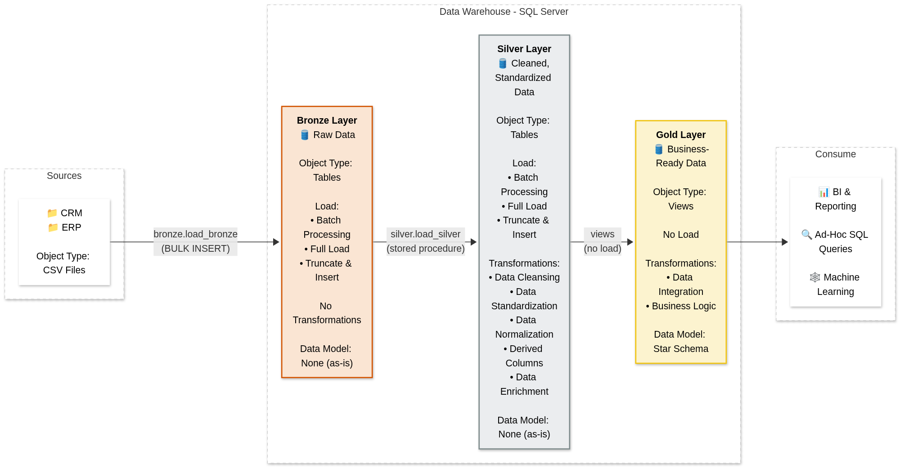
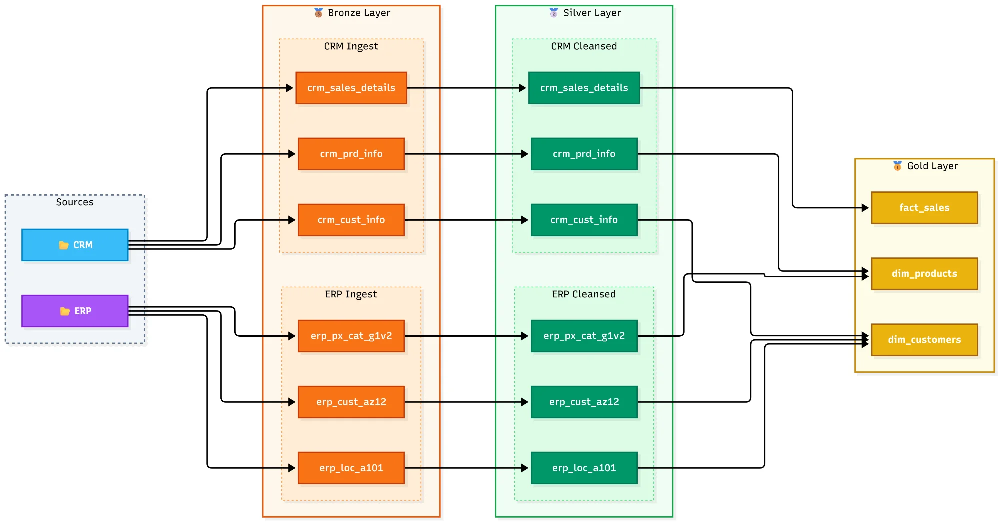
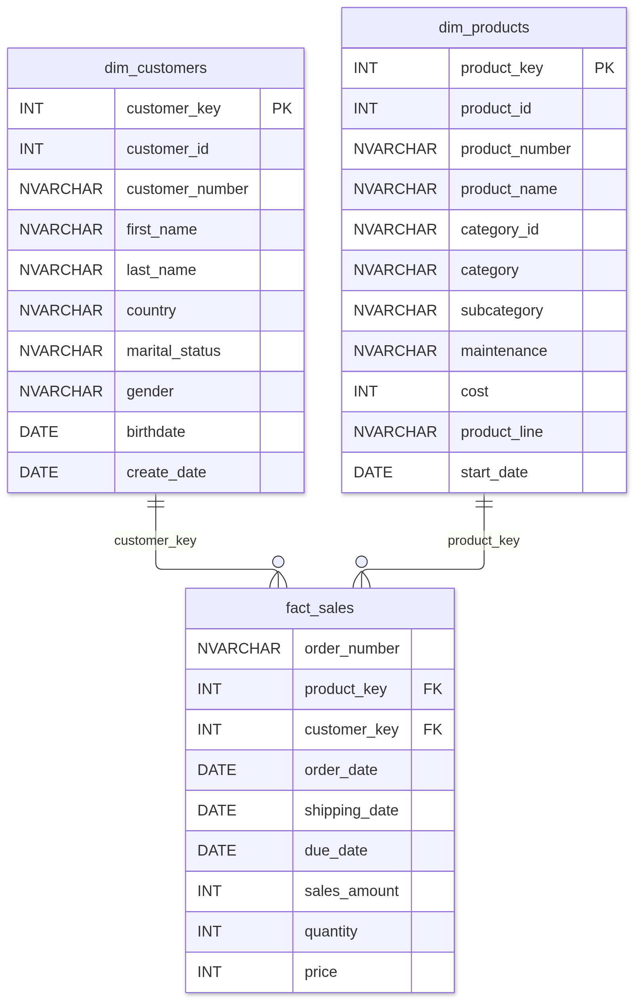

# SQL Data Warehouse Project

**Author:** Ashwani Tripathi

A data warehouse built in **Microsoft SQL Server** using the **Medallion Architecture** (Bronze, Silver, Gold). It combines sales data from two separate source systems, a CRM and an ERP, into one clean model for reporting.



## Status

| Layer | Status | What it does |
|---|---|---|
| Bronze | Implemented | Loads the 6 raw CSV files into raw NVARCHAR columns |
| Silver | Implemented | Cleans, standardises and aligns keys across CRM and ERP; rerun and validate after the latest fixes |
| Gold | Built | Star schema views: `dim_customers`, `dim_products`, `fact_sales` |

## Source data

| System | File | Contents | Rows |
|---|---|---|---:|
| CRM | `cust_info.csv` | Customers: name, marital status, gender, created date | 18,494 |
| CRM | `prd_info.csv` | Products: key, name, cost, product line, start date | 397 |
| CRM | `sales_details.csv` | Sales orders: dates, quantity, price, sales amount | 60,398 |
| ERP | `CUST_AZ12.csv` | Customer birthdate and gender | 18,484 |
| ERP | `LOC_A101.csv` | Customer country | 18,484 |
| ERP | `PX_CAT_G1V2.csv` | Product category, subcategory, maintenance flag | 37 |

The files are in [`datasets/`](datasets/). The sample CRM/ERP data comes from the public "SQL Data Warehouse Project" course by Data With Baraa. The project uses the public sample datasets from Data With Baraa. I developed the project logic and transformation decisions, with AI assistance for some code drafting and review.

## Data profiling: issues found

- Leading and trailing spaces in names and keys
- Coded values: `M`/`S` for marital status, `M`/`F` for gender, `R`/`M`/`S`/`T` for product lines
- ERP gender written two ways (`Male`/`Female` and `M`/`F`)
- Countries written several ways (`US`, `USA`, `United States`, `DE`, `Germany`) plus blanks
- Duplicate and missing customer IDs
- Product start dates in `dd-mm-yyyy` text format
- Invalid sales dates (`0`, `5489`, `32154`) stored as integers
- Missing or negative prices and sales amounts that don't equal quantity × price
- Impossible birthdates (for example `9999-11-20`)
- Different customer ID formats between CRM and ERP
- ERP gender came through as all `n/a`/NULL on one load; the Silver gender rule now strips any hidden carriage return (`CHAR(13)`) before mapping, and `tests/quality_checks_silver.sql` checks every last CSV column for it

## How I built it

| Step | File | What it does |
|---|---|---|
| 0 | `scripts/00_init_database.sql` | Creates the `DataWarehouse` database and the bronze, silver and gold schemas |
| 1 | `scripts/01_bronze_create_tables.sql` | Creates the 6 Bronze tables, every column `NVARCHAR(50)` so no raw row fails to load |
| 2 | `scripts/02_bronze_bulk_upload.sql` | `BULK INSERT` of the 6 CSV files into Bronze |
| 3 | `scripts/03_silver_create_tables.sql` | Creates the 6 typed Silver tables (`INT`, `DATE`), plus `cat_id` on products |
| 4 | `scripts/04_silver_clean_data.sql` | Cleaning `SELECT`s on Bronze, one per table, with the problems found |
| 5 | `scripts/05_silver_insert_tables.sql` | `TRUNCATE` + `INSERT INTO ... SELECT`, one table at a time |
| 6 | `scripts/06_load_procedures.sql` | Wraps steps 2 and 5 in `bronze.load_bronze` and `silver.load_silver` (load times, `TRY...CATCH` with `THROW`) |
| 7 | `scripts/07_gold_views.sql` | Star schema views: `dim_customers`, `dim_products`, `fact_sales` |

**Transformations applied**

| Table | Rules |
|---|---|
| crm_cust_info | `TRIM` text; decode marital status and gender; keep the latest record per customer with `ROW_NUMBER()`; exclude blank or invalid IDs |
| crm_prd_info | Split `prd_key` into `cat_id` and `prd_key`; cost `NULL` to 0; decode product line; `CONVERT(DATE, ..., 105)` for dd-mm-yyyy dates; derive `prd_end_dt` with `LEAD()` minus one day |
| crm_sales_details | Invalid integer dates to `NULL`; parse numeric fields safely; derive missing/invalid price first; then reconcile sales to quantity × price so valid sales are not lost |
| erp_cust_az12 | Strip `NAS` prefix from IDs; cast birthdate to `DATE`, future dates to `NULL`; remove `CHAR(13)` and standardise gender |
| erp_loc_a101 | Remove hyphens from IDs; map `US`/`USA` to United States and `DE` to Germany; blanks to `n/a` |
| erp_px_cat_g1v2 | `TRIM` all columns |



Join keys and the full flow are in [`docs/data_flow.md`](docs/data_flow.md). The layer design is in [`docs/architecture.md`](docs/architecture.md). Interview explanations and design trade-offs are in [`docs/interview_guide.md`](docs/interview_guide.md).

## Gold layer: star schema

`fact_sales` (one row per order line) links to `dim_customers` and `dim_products` by surrogate keys generated with `ROW_NUMBER()` (SQL Server returns `BIGINT`). `dim_customers` joins the CRM customer to both ERP tables; gender comes from the CRM, and from the ERP when the CRM has `n/a`. `dim_products` keeps only current products. Full model: [`docs/data_model.md`](docs/data_model.md).



## How to run

1. Run `scripts/00_init_database.sql` once. **Warning:** it drops and recreates the `DataWarehouse` database.
2. Change the `D:\...` file paths in steps 2 and 6 to where the `datasets/` folder is on your machine.
3. Run steps 01 to 07 in order. Every file starts with `USE DataWarehouse;`.
4. After that, a full reload is:

```sql
EXEC bronze.load_bronze;
EXEC silver.load_silver;
```

5. Run `tests/quality_checks_silver.sql` and `tests/quality_checks_gold.sql`. Each query says what result to expect; most should return no rows.

## Repository structure

```
datasets/
  source_crm/        cust_info.csv, prd_info.csv, sales_details.csv
  source_erp/        CUST_AZ12.csv, LOC_A101.csv, PX_CAT_G1V2.csv
docs/
  data_architecture.png  Medallion architecture
  data_flow.png      Pipeline diagram
  data_model.png     Star schema
  data_flow.md       Mermaid diagram and join keys
  architecture.md    Medallion layer design
  data_model.md      Gold star schema
  interview_guide.md Interview explanation and design trade-offs
scripts/
  00_init_database.sql
  01_bronze_create_tables.sql
  02_bronze_bulk_upload.sql
  03_silver_create_tables.sql
  04_silver_clean_data.sql
  05_silver_insert_tables.sql
  06_load_procedures.sql
  07_gold_views.sql
tests/
  quality_checks_silver.sql   Checks to run after the Silver load
  quality_checks_gold.sql     Checks to run after creating the Gold views
```

## Next steps

- Power BI report on the Gold layer

## License

MIT, see [LICENSE](LICENSE).
