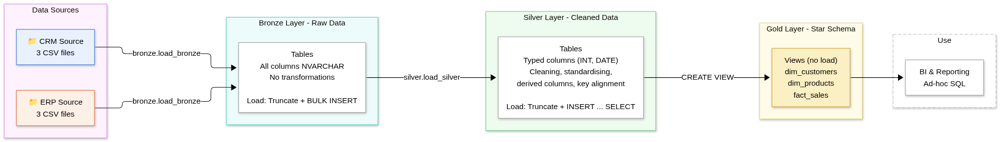
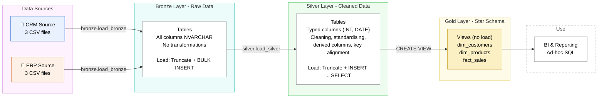

# Architecture

Medallion architecture on SQL Server. GitHub draws the Mermaid diagram automatically.

## Layers

| Layer | Object | How it is loaded | What happens |
|---|---|---|---|
| Bronze | Tables | `bronze.load_bronze`: truncate, then `BULK INSERT` each CSV | Nothing, data kept as received |
| Silver | Tables | `silver.load_silver`: truncate, then `INSERT ... SELECT` from Bronze | Cleaning, standardising, derived columns, key alignment |
| Gold | Views | Not loaded; views read Silver at query time | Joins CRM and ERP into a star schema |
