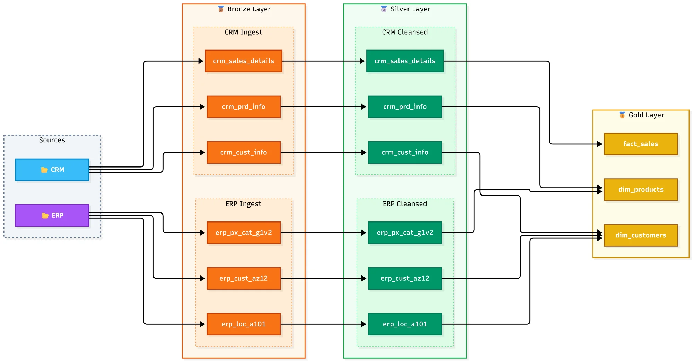
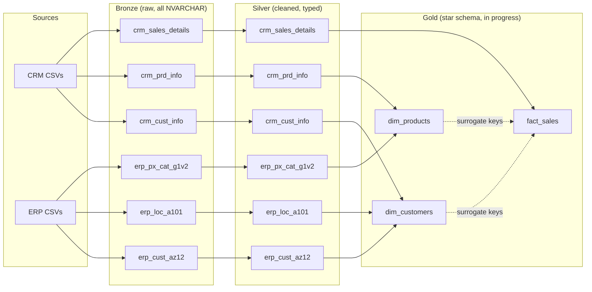

# Data Flow

The same flow as a Mermaid diagram (GitHub draws it automatically):

## Join keys aligned in Silver

| Link | CRM value | ERP value | Silver rule |
|---|---|---|---|
| Customer to ERP demographics | `cst_key` = AW00011000 | `CID` = NASAW00011000 | Strip the `NAS` prefix |
| Customer to ERP location | `cst_key` = AW00011000 | `CID` = AW-00011000 | Remove the hyphen |
| Product to category | `prd_key` = CO-RF-FR-R92B-58 | `ID` = CO_RF | First 5 characters, `-` to `_` |
| Product to sales | `prd_key` (from character 7) = FR-R92B-58 | `sls_prd_key` | Substring from position 7 |
| Sales to customer | `cst_id` | `sls_cust_id` | Direct match |
