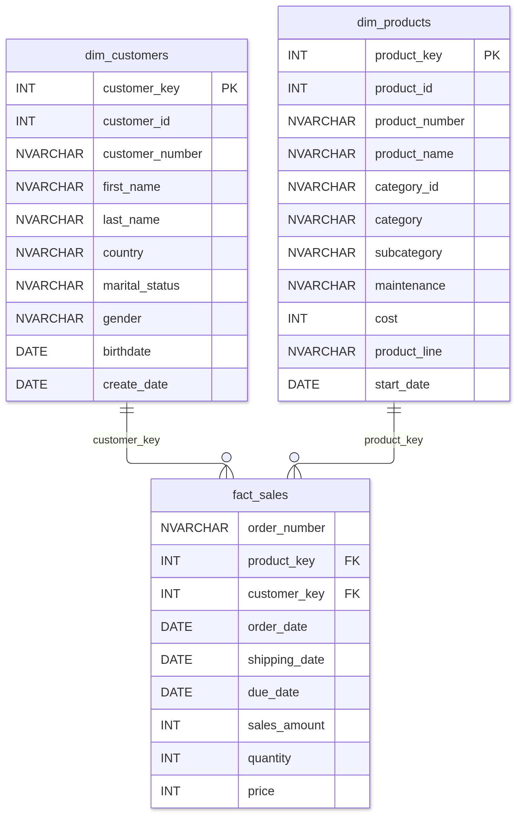
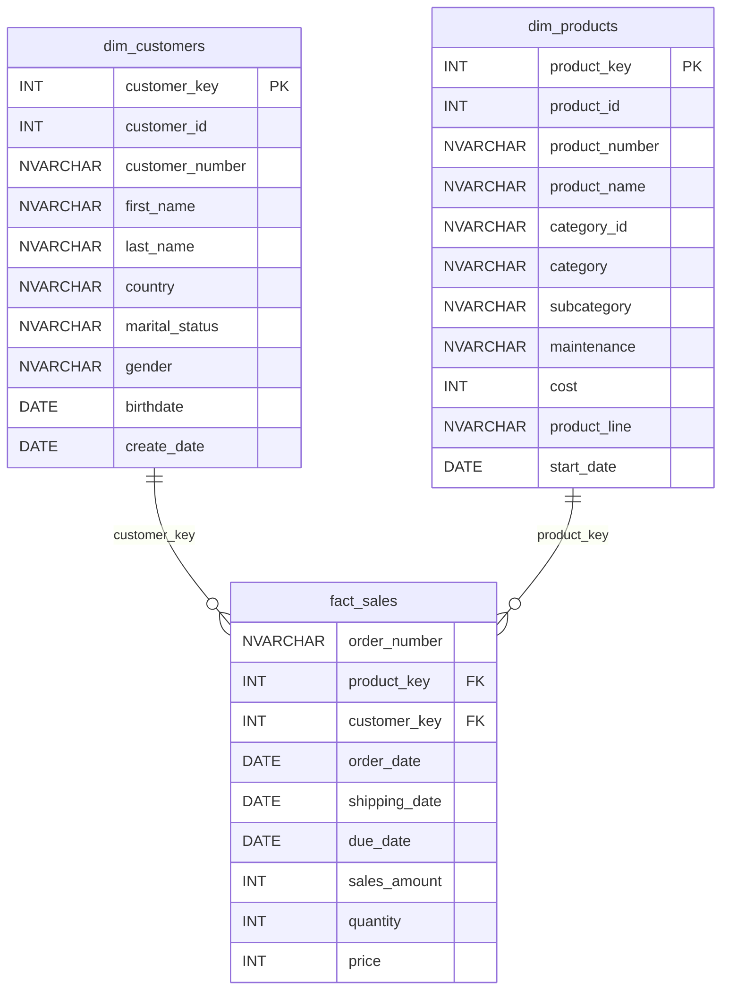

# Gold Data Model (Star Schema)

One fact table and two dimensions. Each dimension has an integer surrogate key (`_key`) made with `ROW_NUMBER()`, plus the source business key (`_number`).

**Grain of `fact_sales`:** one row per order line (`order_number` + `product_key`).

## How the keys are built

| Gold column | Built from | Why |
|---|---|---|
| `customer_key` | `ROW_NUMBER() OVER (ORDER BY cst_id)` | Warehouse-owned key, independent of the CRM |
| `customer_number` | `cst_key` (e.g. AW00011000) | Business key, used to join the ERP tables |
| `product_key` | `ROW_NUMBER() OVER (ORDER BY prd_start_dt, prd_key)` | Warehouse-owned key |
| `product_number` | `prd_key` (e.g. FR-R92B-58) | Business key, used to join sales |

`dim_products` keeps only current products (`prd_end_dt IS NULL`), so each `prd_key` appears once and sales do not duplicate.
